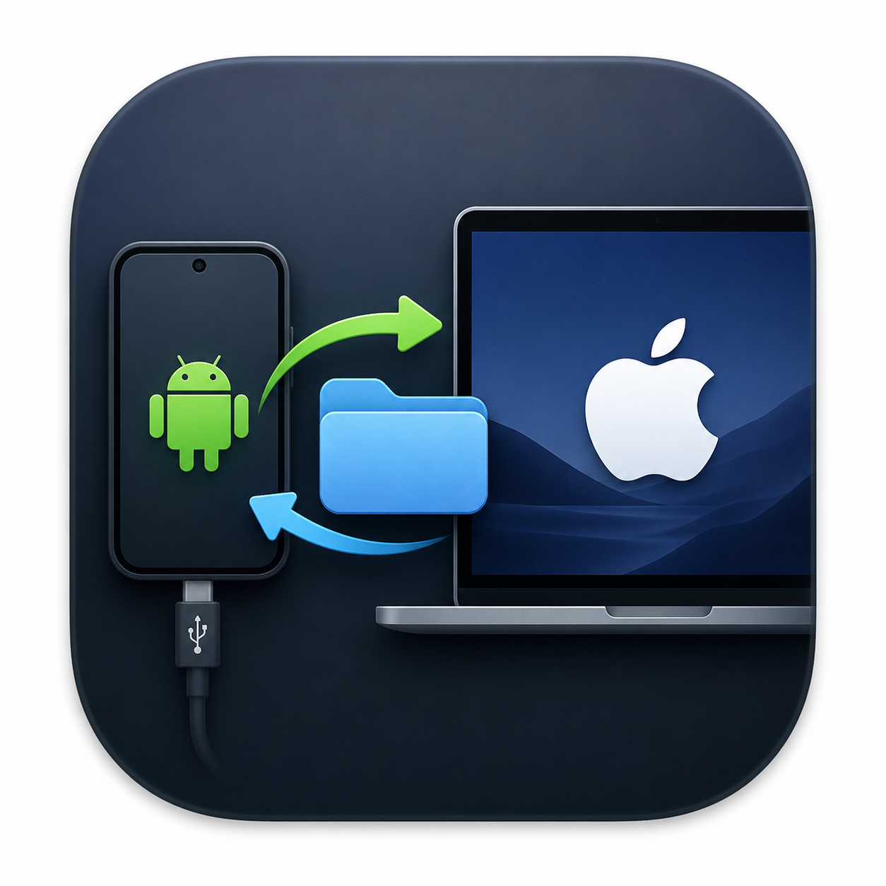

<p align="center">
  
</p>

<h1 align="center">Android File Transfer</h1>

<p align="center">
  A native macOS app for browsing and moving files on an Android phone, built to feel like Finder.
</p>

<p align="center">
  <a href="https://github.com/darot-chen/Android-File-Transfer/releases/latest">Download the latest release</a>
</p>

---

It talks to your phone over USB using Google's `adb` (Android Debug Bridge), which comes bundled inside the app. You don't need to install Android Studio or any other tools.

## Features

- **Browse your phone like Finder.** Use list or grid view, sort by name, date or size, filter the current folder, or search the whole device.
- **Thumbnails.** Photos and videos show previews at their real shape, so you can tell portrait from landscape at a glance.
- **Quick Look.** Select a file and press <kbd>Space</kbd> to preview it.
- **Drag and drop both ways.** Drop files from your Mac into a folder to upload them, or drag files from the phone into Finder or onto your Desktop. Multi-select works for both.
- **Library.** Browse all Images, Videos, Audio, Documents, Archives or APKs on the phone, wherever they're stored.
- **Transfers panel.** See progress, speed and time remaining for each transfer. Several can run at once, and you can cancel or retry them.
- **File management.** Rename, delete, create folders, copy a file's path, or open Get Info.
- **Favorites.** Star a folder to pin it to the sidebar.
- **Device info.** See the phone's model, Android version and free storage.
- **Light, dark or system appearance.**

## Requirements

- macOS 15 (Sequoia) or later, on Apple silicon or Intel
- An Android phone with **USB debugging** turned on
- A USB cable that carries data, not just power

## Install

1. Download `AndroidFileTransfer.zip` from the [latest release](https://github.com/darot-chen/Android-File-Transfer/releases/latest).
2. Unzip it and move **AndroidFileTransfer.app** to your Applications folder.
3. The app isn't notarized by Apple. The first time you open it, right-click the app and choose **Open**, then confirm. If that doesn't work, go to **System Settings → Privacy & Security** and click **Open Anyway**.

## Connect your phone

1. On the phone, go to **Settings → About phone** and tap **Build number** seven times to unlock Developer options.
2. Go to **Settings → Developer options** (sometimes under **System**) and turn on **USB debugging**.
3. Connect the phone to your Mac and unlock it.
4. When the phone asks **"Allow USB debugging?"**, tap **Allow**. Tick "Always allow from this computer" to skip this prompt next time.

The phone appears in the sidebar and opens automatically.

## Keyboard shortcuts

| Shortcut | Action |
|---|---|
| <kbd>Space</kbd> | Quick Look the selected file |
| <kbd>⌘</kbd> <kbd>↑</kbd> | Go to the enclosing folder |
| <kbd>⌘</kbd> <kbd>R</kbd> | Reload the folder |
| <kbd>⇧</kbd> <kbd>⌘</kbd> <kbd>F</kbd> | Search the device |
| <kbd>⇧</kbd> <kbd>⌘</kbd> <kbd>N</kbd> | New folder |
| <kbd>⇧</kbd> <kbd>⌘</kbd> <kbd>T</kbd> | Show or hide Transfers |
| <kbd>⌘</kbd> <kbd>,</kbd> | Settings |

## Troubleshooting

- **The phone doesn't appear.** Check that USB debugging is on, try another cable or port, and unlock the phone.
- **"Allow USB Debugging" is shown.** Unlock the phone and tap **Allow** on the prompt. If you don't see it, unplug the phone and plug it back in.
- **The phone shows as offline.** Unplug it and plug it back in.
- **Something else went wrong.** Open the log viewer from the toolbar (the magnifying-glass document icon) to see the `adb` commands and any errors. You can export the log from there.

## Build from source

You need Xcode 16 or later and [XcodeGen](https://github.com/yonaskolb/XcodeGen).

```sh
brew install xcodegen

# Download Google's adb into the app's resources (it isn't committed to the repo)
./Scripts/update-adb.sh

# Generate the Xcode project from project.yml (the .xcodeproj isn't committed)
./Scripts/generate.sh

open AndroidFileTransfer.xcodeproj
```

Run tests with <kbd>⌘</kbd> <kbd>U</kbd> in Xcode. Some integration tests need a real phone connected. To run only the unit tests from the command line:

```sh
xcodebuild test -project AndroidFileTransfer.xcodeproj -scheme AndroidFileTransfer \
  -destination 'platform=macOS' -only-testing:AndroidFileTransferTests
```

To make a release build, set `MARKETING_VERSION` in `project.yml`, regenerate the project, and build with `-configuration Release`.

## How it works

The app is written in Swift 6 and SwiftUI, using MVVM and async/await:

```
SwiftUI views → view models → services → adb process runner → bundled adb
```

- **Services** (`AndroidFileTransfer/Services`) wrap `adb` commands: device tracking (`adb track-devices`), file listing and file operations (`adb shell`), and transfers (`adb push` / `adb pull`). Each service sits behind a protocol, so tests can replace it with a mock.
- **Features** (`AndroidFileTransfer/Features`) each have their own views and view models: device list, file browser, library, transfers, favorites, settings and logs.
- **Transfer progress.** `adb` doesn't print progress when its output isn't a terminal, so the app polls how many bytes have arrived instead.

You can also point the app at your own `adb` in **Settings → Advanced**.
